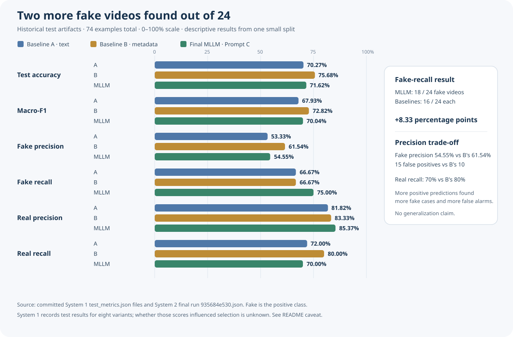
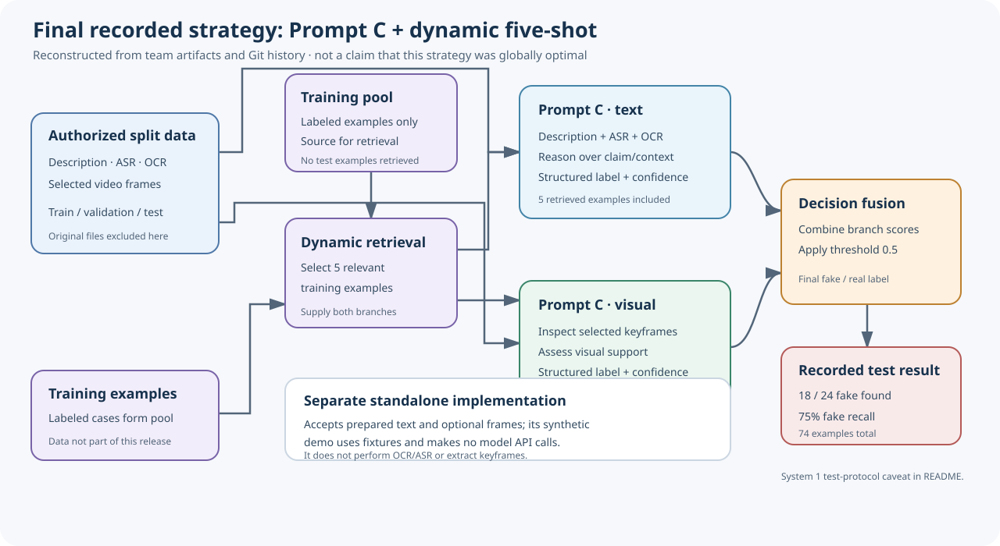
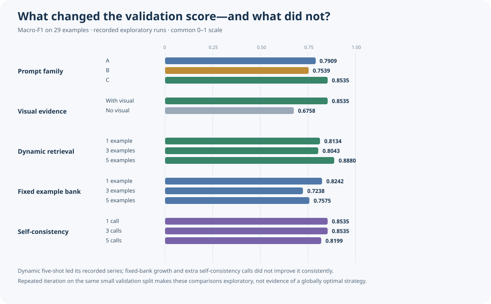

# FakeTT: Multimodal Misinformation Detection

**Can structured multimodal reasoning and dynamically retrieved examples improve misinformation detection compared with simpler text-based classifiers?**

In the recorded 74-video test run, the final multimodal system identified **18 of 24 fake videos (75.00% recall)**, compared with **16 of 24 (66.67%)** for each TF-IDF baseline: an **8.33 percentage-point recall increase**. It also mislabeled five more real videos as fake than metadata Baseline B, and its macro-F1 was lower. This is a small, single-split result—not evidence of a statistically established generalization gain.

## What we set out to learn

The DAT560 team project compared an interpretable TF-IDF + Logistic Regression baseline with a prompt-driven multimodal LLM workflow for short-video misinformation detection. The research question was whether structured reasoning over words and visual evidence, paired with dynamically retrieved examples, could improve on simpler text classifiers.

The answer in this run is mixed: the final Prompt C strategy had higher fake-news recall than either baseline, but lower fake precision than Baseline B and lower macro-F1 than the strongest classical baseline. The reported model was Gemma 4 31B (gorina10.gemma4:31b), using separate text and visual evidence prompts, dynamic five-shot retrieval, decision-level fusion, and a 0.5 threshold.

## Recorded test results

| System / configuration | Accuracy | Macro-F1 | Fake videos found |
| --- | ---: | ---: | ---: |
| Baseline A: description + ASR + OCR | 70.27% | 0.6793 | 16 / 24 |
| Baseline B: A + user description + event | **75.68%** | **0.7282** | 16 / 24 |
| Final MLLM: Prompt C, dynamic 5-shot, visual | 71.62% | 0.7004 | **18 / 24** |

| System | Fake precision | Fake recall | Real precision | Real recall |
| --- | ---: | ---: | ---: | ---: |
| Baseline A | 53.33% | 66.67% | 81.82% | 72.00% |
| Baseline B | **61.54%** | 66.67% | 83.33% | **80.00%** |
| Final MLLM | 54.55% | **75.00%** | **85.37%** | 70.00% |

Fake is the positive class. Relative to both baselines, the MLLM's fake recall increased by **8.33 points**. Relative to Baseline B, fake precision fell by **6.99 points**; the MLLM also produced 15 false positives versus Baseline B's 10. Its real-class recall was 10 points lower than Baseline B, while real precision was higher because it labeled more examples as fake. Its macro-F1 was 0.0278 below Baseline B. Relative to text-only Baseline A, the MLLM's macro-F1 was 0.0211 higher.

The test split had **74 examples: 24 fake and 50 real**. These figures come from the original team's committed metric artifacts, not from the synthetic demo in this repository. The exact metric inputs and calculations are recorded in [docs/historical_results.json](docs/historical_results.json).

### Test-protocol caveat

The course report describes a locked test split, but the System 1 runner's committed aggregate summary records test metrics for **all eight variants** in one run. The runner code computes and saves test predictions and metrics inside each variant run. This is evidence that the test set was evaluated repeatedly across configurations. The available files do **not** establish whether those results influenced selection, so this portfolio should not claim an untouched or single-use System 1 test. For System 2, Git history shows a best-validation-results artifact was committed before the final test artifact, but it cannot rule out unrecorded experimentation or external decisions. The final MLLM result is one recorded test run, not proof of a pristine protocol.

## How the final strategy works

Prompt C splits the evidence into two analyses. A text branch reasons over the description, ASR, and OCR; a visual branch inspects selected video frames. Dynamic retrieval selects five similar examples from the training pool. The two structured outputs are combined by decision-level fusion and thresholded into a final label.

This architecture is an independently drawn summary of the group's reported approach. The standalone package implements a fresh, synthetic-data-capable research harness; it does not include the original dataset, keyframes, few-shot examples, or service configuration.

## What the ablations taught us

The following are historical **validation** macro-F1 scores on 29 examples. They are exploratory comparisons from repeated prompt/configuration iteration, not confidence intervals or proof that one strategy generalizes best.

| Experiment | Recorded validation macro-F1 | Readout |
| --- | ---: | --- |
| Prompt A / B / C, zero-shot | 0.7909 / 0.7539 / 0.8535 | C led on this split. |
| Prompt C, visual / no visual | 0.8535 / 0.6758 | The visual run scored higher; a small, repeatedly queried split cannot establish a robust visual contribution. |
| Dynamic 1 / 3 / 5-shot | 0.8134 / 0.8043 / 0.8880 | Five-shot was best in this recorded series; three-shot did not improve on one-shot. |
| Fixed 1 / 3 / 5-shot | 0.8242 / 0.7238 / 0.7575 | Increasing a manually selected bank did not help in this series. |
| Self-consistency 1 / 3 / 5 calls | 0.8535 / 0.8535 / 0.8199 | Three calls tied one; five calls scored lower while requiring more calls. |
| Clean-OCR Prompt C, separate run | 0.8919 | A different input variant; not the final test configuration. |

The selected final configuration is the recorded Prompt C + dynamic five-shot + visual strategy. It was not shown to be globally optimal: many configurations were tried on one small validation split, and only one final MLLM test result is recorded.

## System design

The original project had two complementary systems:

- **System 1 — supervised text baseline:** schema and split investigation, preprocessing and OCR/ASR audits, duplicate/leakage analysis, text construction, TF-IDF + Logistic Regression, baseline/metadata experiments, and evaluation/error analysis.
- **System 2 — collaborative multimodal experimentation:** initial prompt-driven pipeline, prompt families, structured output, separate Prompt C text/visual analysis, fixed and dynamic few-shot retrieval, late fusion, and prompt/configuration ablations.

The current standalone implementation is intentionally narrower than the course pipeline. It accepts prepared OCR/ASR text and optional extracted frames; it does not decode videos or perform OCR, ASR, or keyframe extraction. The synthetic fixtures test software paths only and make no network calls.

## My contribution and team credit

**Mahdi Nasser — System 1 owner and principal contributor to the selected System 2 strategy**

- Had full responsibility for developing System 1, including the TF-IDF + Logistic Regression baseline, dataset investigations, preprocessing audits, OCR/ASR quality analysis, leakage and duplicate checks, baseline experiments, evaluation, and related analysis.
- Collaborated with teammates on implementing and improving System 2. Teammates developed its initial implementation with his assistance.
- Proposed and developed the final selected Prompt C strategy with dynamic five-shot retrieval, separate text/visual analysis, and decision-level fusion; also experimented with prompting strategies, configurations, and evaluation approaches.

The project report credits **Abel Segaye, Azhar Ahmad, Bashar Albittar, and Mahdi Nasser** as authors. System 2 was collaborative; this account does not claim Mahdi independently created the entire System 2 architecture or that the team project was solely his work. The original Git history corroborates Mahdi's extensive System 1 commits and later System 2 prompt, retrieval, and ablation work, alongside teammate-authored initial System 2 work. Git history alone does not assign every team member's role, so the public credit preserves the full author list without inventing a role breakdown. See [docs/contributors.md](docs/contributors.md) for the contribution evidence.

## Reproduce the standalone demonstrations

This repository is a **clean-room implementation**, separate from the historical experiment. It includes 20 invented rows, abstract generated icons, and static model-response fixtures. No FakeTT examples or labels are used in these commands.

On Windows with Python 3.11:

~~~powershell
python -m venv .venv
.\.venv\Scripts\python.exe -m pip install -e ".[dev]"
.\.venv\Scripts\python.exe -m pytest -vv
.\.venv\Scripts\python.exe -m fakett_research.demo
.\.venv\Scripts\python.exe -m fakett_research.mllm --csv data/synthetic/demo.csv --family c --few-shot dynamic --n-shot 2 --tune-threshold --mock-fixtures data/synthetic/mock_responses.json --output runs/cli-demo.json
.\.venv\Scripts\python.exe scripts/audit_release.py
.\.venv\Scripts\python.exe scripts/check_docs.py
~~~

The same commands were verified in this local Python 3.11.9 environment. The demo MLLM scores intentionally include one wrong synthetic test prediction to exercise error metrics; they are not FakeTT results. For authorized input data and a compatible endpoint, the CLI accepts a CSV and reads OPENAI_BASE_URL, OPENAI_API_KEY, and OPENAI_MODEL from the environment. See the package help and keep access-controlled data outside the repository.

## Data, provenance, and publication status

The release excludes original data splits, identifiers, metadata, OCR/ASR text, keyframes, source videos, few-shot banks, prompts with real examples, cached responses, predictions, credentials, academic report files, and the original Git history. Synthetic assets and examples are clearly identified. The [release audit](scripts/audit_release.py) checks for common accidental inclusions; the public tree has also been reviewed against the private team's tracked source and data inventory.

The standalone implementation is new software that re-creates the reported high-level workflow; it is not a copy of the course code. The historical measurements are attributed to the four-person team and to the team's committed aggregate artifacts. The test-protocol discrepancy remains disclosed above. The [MIT license](LICENSE) applies only to this repository's independently authored software, synthetic fixtures/assets, and newly written documentation. It does not grant rights to the FakeTT dataset, third-party material, or the original DAT560 team repository or report. FakeTT access is separately controlled by its dataset project; this repository includes none of that material. See the [source and data audit](docs/source_audit.md) and [release review](docs/release_readiness.md).

## References

- Bu et al. (2024), *FakingRecipe: Detecting Fake News on Short Video Platforms from the Perspective of Creative Process*. See the [official dataset and paper repository](https://github.com/ICTMCG/FakingRecipe).
- DAT560, [TikTok misinformation detection project brief](https://github.com/dat560-2026/info/blob/main/projects/tiktok.md).
- Team report: *Improving Multimodal Fake-News Detection on FakeTT with Off-the-Shelf Models and Prompt Engineering*, University of Stavanger.
